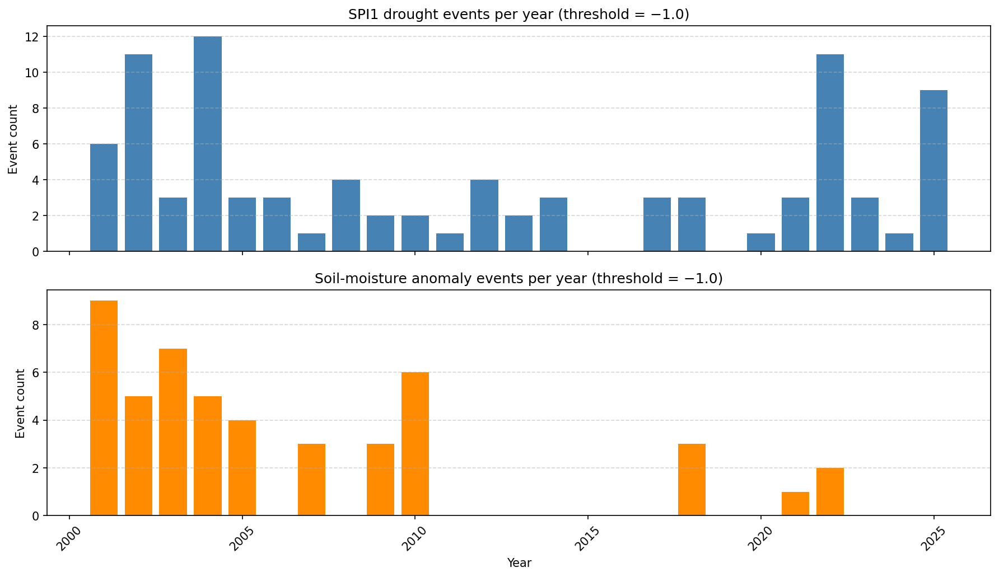
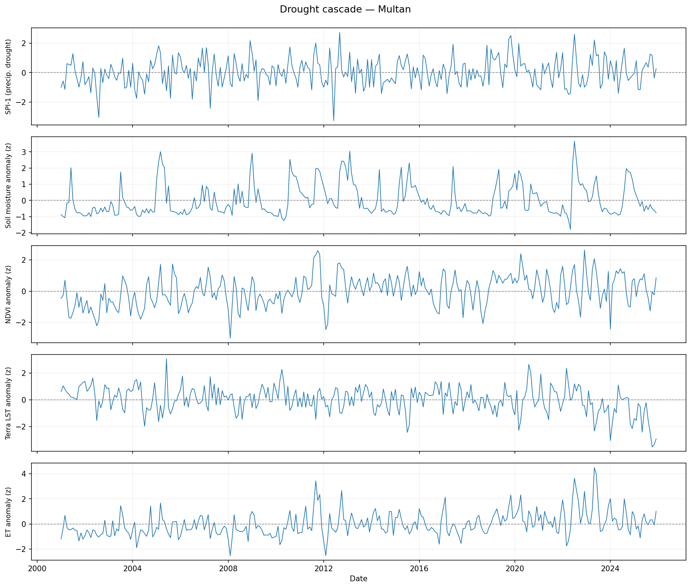
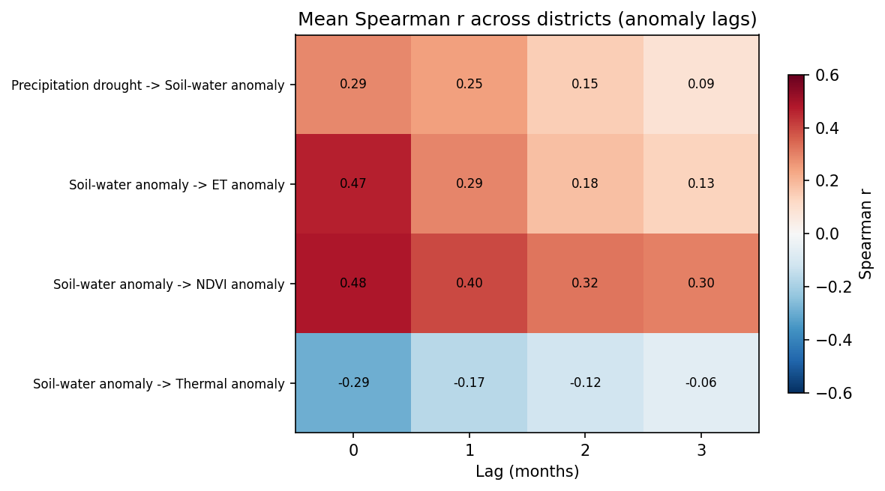
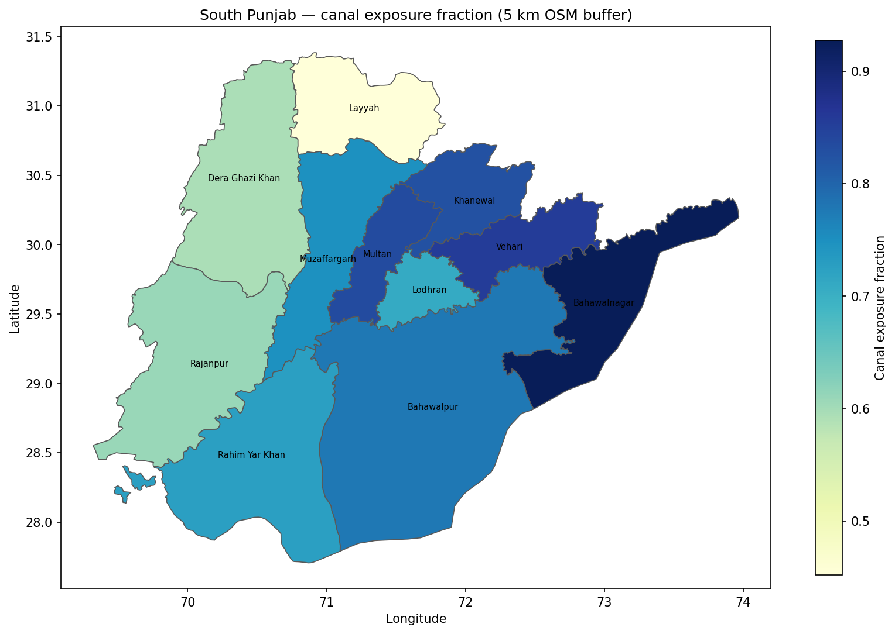
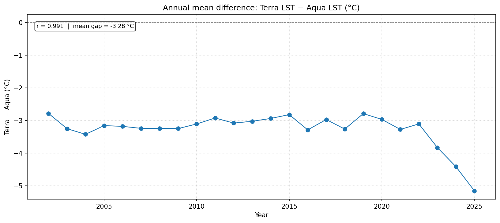

# Drought Event Analysis in South Punjab, Pakistan (2001–2025)

**Multi-sensor remote sensing and reanalysis of precipitation, soil moisture, vegetation, thermal responses, and exploratory wheat-yield relationships**

**Author:** Musab Shahid  
**Context:** Independent research application report prepared for Dr. Chaolei Zheng, Aerospace Information Research Institute (AIRCAS), Chinese Academy of Sciences, September 2026. This description does not imply employment or institutional endorsement.

## Overview

This study examines drought events across 11 districts of South Punjab, Pakistan, using monthly environmental observations and reanalysis products for 2001–2025. It assesses precipitation and soil-moisture drought events, cross-variable temporal associations, mapped canal proximity, and exploratory relationships with district-level wheat yields.

**Study districts:** Multan, Khanewal, Vehari, Lodhran, Bahawalpur, Bahawalnagar, Rahim Yar Khan, Muzaffargarh, Layyah, Dera Ghazi Khan, and Rajanpur.

## Data sources

| Variable | Source | Role |
|---|---|---|
| Precipitation | CHIRPS v3 | SPI-1 and SPI-3 |
| Soil water (0–100 cm) | ERA5-Land reanalysis | Soil-moisture anomalies and drought events |
| Daytime land-surface temperature | MODIS Terra MOD11A2; Aqua MYD11A2 | Thermal anomalies; cross-platform consistency |
| Vegetation | MODIS MOD13Q1 NDVI | Vegetation response |
| Evapotranspiration | MODIS MOD16A2GF | ET response |
| Cropland and canals | ESA WorldCover 2021; OpenStreetMap canals | Static canal-proximity proxy |
| Wheat yields | Official agricultural series, with limited gap filling described in report | Exploratory yield regressions |

**Important:** ERA5-Land soil water is modeled/reanalysis data, not a direct satellite soil-moisture observation. Canal proximity is not equivalent to actual irrigation or water delivery.

## Analytical workflow

1. Assemble monthly district-level data in Google Earth Engine and Python/Colab.
2. Calculate SPI-1, SPI-3 and calendar-month standardized soil-water anomalies.
3. Detect drought events using threshold-based run theory (including a one-month gap-pooling rule and minimum two-month duration).
4. Estimate Spearman lag associations (0–3 months), with false-discovery-rate correction.
5. Compare Terra and Aqua MODIS LST records as a consistency check.
6. Calculate cropland proximity to mapped canals using 5 km buffers and 2/10 km sensitivity checks.
7. Explore wheat-yield residual relationships using district and harvest-year fixed effects; report limitations and sensitivity.

## Selected findings

- At the primary −1.0 threshold, **91 SPI-1 events** and **48 soil-moisture events** were identified across the study districts.
- All four assessed environmental relationships showed their strongest associations at **zero-month lag**; these are associations, not evidence of a causal cascade.
- The report found **no statistically significant wheat-yield or canal-interaction effect** in the three prespecified regression specifications. The sensitivity to buffer distance limits interpretation.
- Terra and Aqua LST were strongly correlated in overlapping district-month observations, but this comparison is **not independent validation**.

These findings are summarized from the final report; this repository does not claim an independent replication of the calculations.

## Project materials

- [Full research archive (Google Drive)](https://drive.google.com/drive/folders/1EFKdIpvvfyv1FfrVnsm2TWeDFcsamxs-?usp=sharing)
- [Final research report (DOCX)](https://docs.google.com/document/d/1OdzCHDSjB3KY8uIO5WPtR0P9SAUqHI1S/edit)
- [Full Colab code pipeline folder](https://drive.google.com/drive/folders/1HKonRpPt7rMJU9qEC31Y8Br-f9n-z_Fj)
- [Analysis outputs folder](https://drive.google.com/drive/folders/1QYWY2lwOiA_Gc5-DgkmRpD3U6hsRLaO-)

**Repository preparation status:** Documentation scaffold only. The notebook, figures and reproducibility instructions will be added after checking their file paths and dependencies. The linked Drive archive remains the source of record.

## Limitations

The analysis is observational; correlations do not establish causal drought propagation. The canal proxy uses a static land-cover/canal snapshot rather than measured irrigation delivery. The wheat-yield panel contains limited gap-filled values, and inference with 11 district clusters is exploratory. Some source records do not cover the entire study period (for example, Aqua LST starts in July 2002).

## Citation

Shahid, M. (2026). *Drought Event Analysis in South Punjab, Pakistan: Multi-Sensor Remote Sensing of Precipitation, Soil Moisture, Vegetation and Thermal Cascades, and Exploratory Implications for Wheat Yield.* Research application report prepared for Dr. Chaolei Zheng, AIRCAS, Chinese Academy of Sciences. Unpublished report.

## Figures

The following images are original output figures from the analysis archive, now included locally in this repository.

### Drought event timelines

### Environmental time series — Multan

### Multi-variable lag correlations

### Canal-exposure geography

### Terra–Aqua thermal consistency

## Reproducing the analysis

See [the execution guide](docs/RUNNING_THE_ANALYSIS.md) and the [original notebook](notebooks/drought_study.ipynb). The notebook runs in Google Colab, uses Earth Engine exports and requires the input and export folders available in the linked Drive archive. The code has been published, but a fresh execution in a clean environment has **not yet been independently demonstrated**.
